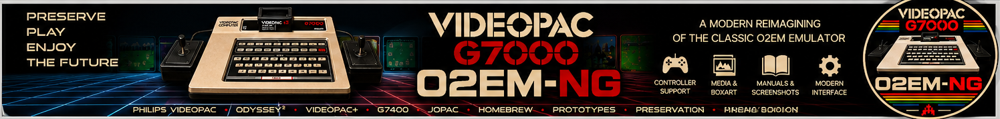

# O2EM-NG



A Windows x64, SDL3-based continuation of the original O2EM emulator for
Philips Videopac G7000 / G7400 and Magnavox Odyssey².

**Current release: Beta 5 / v5.0.2 Licensing & Attribution Update.** The
previous published release is
[v5.0.1 (Beta 5)](https://github.com/bengtovepeltz-design/O2EM-NG/releases/tag/v5.0.1).
This update corrects copyright notices, licensing documentation, source
provenance and credits; the NG emulation engines are unchanged.

[Downloads](https://github.com/bengtovepeltz-design/O2EM-NG/releases) |
[Quick start](Beta_5_v5.0.2_Quick%20start%20guide.md) |
[Changelog](CHANGELOG.md) |
[Credits](CREDITS.md) |
[Source provenance](SOURCE_PROVENANCE.md) |
[Third-party notices](THIRD_PARTY_NOTICES.md) |
[Project notes](Project.md)

## What's new in v5.0.2

- **Original O2EM notices:** restored the exact O2EM copyright notice and added
  the Clarified Artistic License section 3 modification notices to modified
  O2EM-derived files.
- **MAME notices:** added the complete BSD 3-Clause notice, copyright holders
  and disclaimer for the adapted i8244/i8245 VDC and EF9340/EF9341 VPP
  portions.
- **Third-party notices:** added the SDL3_ttf licence, a Microsoft Visual C++
  runtime notice and a consolidated `THIRD_PARTY_NOTICES.md`.
- **Source provenance:** added `SOURCE_PROVENANCE.md` with component-level
  origins, licences, upstream revisions and open questions.
- **Credits:** added `CREDITS.md` as the canonical credits source and expanded
  the application About, Credits and Special Thanks pages.
- **Website:** added a dedicated Credits page to the official website.
- **Packaging:** the installer and portable package now include the notices,
  provenance and credits documents.

The NG emulation engines, C7010 support, audio, video, timing, input, databases
and collections are unchanged in this licensing update. Existing v5.0.0 and
v5.0.1 installations upgrade in place and preserve user data.

## What's new in Beta 5

- **New NG emulation core**: new MCS48 CPU, unified machine scheduler and
  timebase, new i8244/i8245 VDC, and G7000/Odyssey² convergence.
- **G7400/Videopac+ support**: EF9340/EF9341/VPP device, Plus title
  compatibility and corrected static-character orientation.
- **New NG audio device** and compatibility/regression improvements.
- **C7010 Chess as NG special hardware**, with the external NSC800 module
  attached to the NG machine.
- Existing frontend, library, database, settings and controller workflows are
  preserved.

Beta 5 v5.0.0 introduced the NG architecture. Its Windows 95-style window,
UTF-8 media paths and C7010 support are retained in v5.0.2, along with the
renamed My Real Collection page and the v5.0.1 UI improvements.

## Features

- Windows 95-style frontend: custom title bar and menu bar, framed banner,
  beveled gray panels and classic 3D buttons.
- Game Library, launcher, favorites and editable game information.
- **My Real Collection**: a separate page and database for your own physical Videopac
  games, with per-component conditions (cartridge / box / manual), a wanted
  list, search, sorting and CSV export.
- Library side panels: Library Folders (open the ROMs, Box Art, Screenshots,
  Manuals and BIOS folders) and live Collection Statistics.
- Integrated Cover / Media viewer with still images, animated GIF and silent
  looping MP4 playback, and per-item media deletion to the Recycle Bin.
- Supplied SQLite game catalogue with titles, descriptions and metadata. Recognized
  ROMs such as `vp_01.bin` populate the library with the matching information,
  and the Videopac number shows whether the ROM is installed.
- Import Center for user-supplied ROMs, box art, PDF manuals and screenshots.
- SDL3 video, audio, keyboard, mouse and Xbox-compatible controller support.
- Fullscreen/windowed operation, Settings, Auto/PAL/NTSC region selection.
- Two-controller gameplay and in-game controller-port swapping.

Navigation: Library, Edit Game Data, Import Center, Manual, Settings, About and
My Real Collection.

The catalogue is included; game ROMs, BIOS/firmware and cover/media files are not.
Media appears when the user supplies matching files. The v5.0.2 packages do not
bundle gameplay screenshots or videos; the `SCREENSHOTS` folder is created for
your own media.

## Getting started

1. Download an available release and install it or extract its portable ZIP.
2. Add your compatible console BIOS to `BIOS` and games to `ROMS`.
3. Run `O2EM-NG.exe`, select the console BIOS in Settings and choose a game.
4. Add optional artwork, manuals and screenshots through the Import Center.

The portable Beta 5 package includes SDL3, SDL3_image, SDL3_ttf, PDFium and the
required Microsoft C++ runtime DLLs beside the executable. Windows system runtime
components are still required. Keep the whole extracted folder together.

### C7010 Chess

In addition to the console BIOS, supply:

```text
BIOS/C7010/c7010_z80.bin   (8 KiB module firmware)
ROMS/vp_C7010.bin         (chess cartridge)
```

Start with **1 -> Y/YES -> 2** to play white at beginner level 2, then enter a move
such as **E2-E4** and press Enter. **N/NO** selects black and reverses the board.
Level **1** is tournament mode, not the easiest level; longer thinking time there
is expected. Exact hardware timing has not been established.

## Controls

| Action | Keyboard | Xbox-compatible controller |
| --- | --- | --- |
| Select in frontend | Enter | A |
| Navigate frontend | Arrow keys | D-pad / left stick |
| Reset game | F5 | B |
| Return from game to frontend | Esc | Back / View |
| Swap joystick ports | - | Y |

Chess setup and moves use the keyboard. Keyboard Y/YES and controller Y have different roles.

## Beta testing

Please test longer chess games, captures, castling, en passant, promotion, both
colours and console configurations. Ordinary-game regression testing is also welcome.
Earlier releases were tested with games including Gunfighter, Atlantis, Golf,
Munchkin and Bowling-Basketball; this is not a fresh compatibility certification
for every title in Beta 5. Four in 1 Row remains a previously recorded issue pending retest.

Reports should include version, Windows version, game/ROM name, console BIOS,
region, startup choices, exact moves or reproduction steps, and screenshots/video.
Do not attach BIOS or ROM files. Use [GitHub issues](https://github.com/bengtovepeltz-design/O2EM-NG/issues)
or the community beta discussion.

## Building and packaging

Open the Visual Studio solution/project and build **Release | x64**. SDK paths
currently refer to the developer's installed SDL libraries; adjust them for your machine.
The build creates a versioned folder and ZIP under `dist` from the explicit list in
`tools/release-manifest.json`. The supplied game catalogue is included; private
configuration and user ROM/media folders are not copied.

See [Release packaging](Release%20packaging.md) for file selection and installer building.
Debug builds do not create distribution packages. Detailed C7010 tracing is opt-in
with the build definition `O2EM_C7010_TRACE=1`.

## Credits and licensing

O2EM-NG builds on the original O2EM work by **Daniel Boris, Andre de la Rocha and
Arlindo M. de Oliveira**, with historical contributions and technical references
from **Mark Guttenbrunner (Manopac)**, **Sören Gust** and others.

O2EM-NG project direction, independently developed NG components, frontend,
library, collection management, C7010 support, testing and packaging:
**Bengt-Ove Peltz**.

Parts of the Intel 8244/8245 VDC and Thomson EF9340/EF9341 VPP implementations
are adapted from MAME's BSD-3-Clause source code. MAME copyright holders for the
referenced files: **Peter Trauner, Wilbert Pol and hap**, with additional
acknowledgement to **Kevin Horton**. MAME is not affiliated with O2EM-NG and
does not endorse it.

Canonical documents:

- [Credits](CREDITS.md)
- [Source provenance](SOURCE_PROVENANCE.md)
- [Third-party notices](THIRD_PARTY_NOTICES.md)
- [COPYRIGHTS.txt](COPYRIGHTS.txt) — Clarified Artistic License and original
  O2EM notice
- [Licences](Licenses/) — full third-party licence texts

O2EM-NG is not a single-licence repository: original O2EM/O2EM-NG code, adapted
MAME portions and third-party libraries have different applicable terms. See the
repository root `LICENSE` index.

BIOS files, C7010 firmware, commercial ROMs, commercial manuals and copyrighted
artwork are not distributed. Users supply their own legally obtained files.
